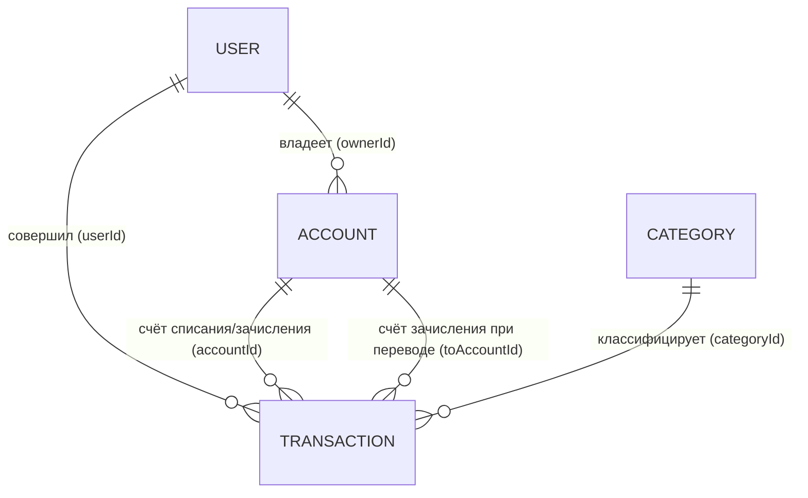

# Бизнес-модель: BudgetTracker

Приложение для персонального учёта бюджета. Один пользователь — свои счета, категории и операции. Учитываются только фактические операции, одна валюта.

## Сущности (4)

### 1. User (Пользователь)
Владелец учётной записи. Вход по логину и паролю.

| Поле | Тип | Описание |
|---|---|---|
| id | uuid | Идентификатор |
| login | string | Уникальный логин для входа |
| email | string | Уникальный email |
| passwordHash | string | Хэш пароля (пароль в открытом виде не хранится) |
| name | string | Имя (отображаемое) |
| avatarColor | string | Цвет аватара |
| createdAt | datetime | Дата регистрации |

### 2. Account (Счёт)
Источник или назначение денег: наличные, карта, кошелёк. Принадлежит одному пользователю.

| Поле | Тип | Описание |
|---|---|---|
| id | uuid | Идентификатор |
| name | string | Название («Наличные», «Карта Сбер») |
| type | enum | cash \| card \| deposit \| other |
| initialBalance | decimal | Начальный баланс при создании |
| ownerId | uuid | Владелец счёта |

### 3. Category (Категория)
Классификация операций + лимит бюджета. Может быть личной или системной (предустановленный набор для всех).

| Поле | Тип | Описание |
|---|---|---|
| id | uuid | Идентификатор |
| name | string | Название («Продукты», «Зарплата») |
| type | enum | expense \| income |
| icon / color | string | Визуальное оформление |
| monthlyLimit | decimal? | Месячный лимит расходов (бюджет). `null` = без лимита |
| isSystem | boolean | Системная категория (нельзя удалить, можно скрыть) |
| ownerId | uuid? | Владелец; `null` = системная категория |

### 4. Transaction (Операция)
Одна фактическая операция: доход, расход или перевод.

| Поле | Тип | Описание |
|---|---|---|
| id | uuid | Идентификатор |
| type | enum | income \| expense \| transfer |
| amount | decimal | Сумма, всегда > 0 |
| date | datetime | Дата и время совершения |
| accountId | uuid | Счёт списания (для expense/transfer) или зачисления (для income) |
| toAccountId | uuid? | Только для transfer: счёт зачисления |
| categoryId | uuid? | Категория. Обязательна для income/expense, пуста для transfer |
| userId | uuid | Кто совершил операцию |
| comment | string? | Произвольный комментарий |

## Связи

- User 1 — N Account: у пользователя несколько личных счетов.
- User 1 — N Transaction: каждую операцию совершил конкретный пользователь.
- Account 1 — N Transaction: операция всегда привязана к счёту.
- Category 1 — N Transaction: у расхода/дохода всегда есть категория; перевод категории не имеет.

## Бизнес-правила

1. **Баланс счёта** вычисляется, не хранится:
   `balance = initialBalance + Σ income − Σ expense ± переводы по этому счёту`.
2. **Перевод** — это одна операция типа transfer между двумя счетами (`accountId` → `toAccountId`). На общую сумму денег пользователя перевод не влияет.
3. **Категория обязательна** для доходов и расходов, запрещена для переводов. Тип категории должен совпадать с типом операции (расход нельзя провести по категории «Зарплата»).
4. **Сумма операции всегда положительная**. Знак определяется типом операции.
5. **Лимит категории** — месячный. При превышении лимита приложение предупреждает, но не блокирует операцию (лимит — ориентир, а не запрет).
6. **Удаление**:
   - Счёт с операциями удалить нельзя — только «архивировать» (перестаёт показываться в выборе, история сохраняется).
   - Категория с операциями удалить нельзя — только скрыть; системную категорию удалить нельзя в принципе.
   - Операцию можно удалить всегда; баланс пересчитывается автоматически.
7. **Изоляция данных**: пользователь имеет доступ только к своим счетам, категориям и операциям (проверяется на каждом запросе по `userId`).
8. **Редактирование операции** свободное, включая смену счёта, категории, суммы и даты.
9. **Регистрация и вход**: логин и email уникальны; при регистрации создаётся системный набор категорий (Продукты, Транспорт, Жильё, Зарплата и т.д.).

## Что осознанно исключено

- Планируемые/регулярные операции — только факт.
- Мультивалютность — одна валюта.
- Совместный доступ / семейный режим — каждый пользователь сам по себе.
- Восстановление пароля, OAuth-вход (Google и т.п.) — на первом этапе только логин + пароль.
- Вложения, кредиты, проценты — out of scope.

Если потребуется добавить сущность (например, PlannedTransaction), придётся либо расширить лимит, либо объединить что-то из текущих четырёх.
